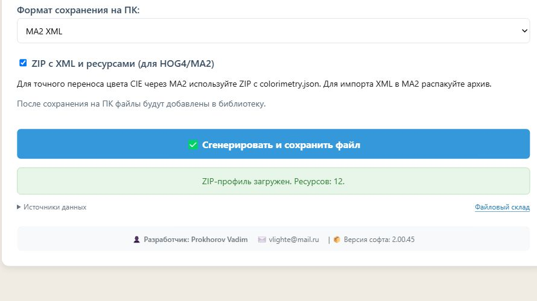

# Точность цвета CIE/XYZ — версия 2.00.45

Версия **2.00.45 установлена на vlighte.ru**. Серверный код, две копии главной страницы и страница библиотеки проверены повторным чтением с хостинга; маркер перезапуска обновлён. На рабочем сайте открыт MA2 ZIP с colorimetry.json и 11 PNG: 17 DMX, 12 ресурсов, ZIP включён автоматически, подсказка о CIE показана. Гостевая библиотека загрузилась, версия 2.00.45 подтверждена. Генерация с записью тестового файла в рабочую библиотеку не запускалась. Этот отчёт включён в контрольную точку 2.00.45 репозитория Vlighte-stack/Vlighte.ru. Подробности — deployment.json.

## Результат

Все **79 прежних случаев потери точности цвета устранены в варианте с ZIP**. 22 цепочки используют только нативные поля GDTF/HOG; 57 цепочек, проходящих через MA2, сохраняют точные данные в согласованном с пользователем открытом colorimetry.json. Сам MA2 по-прежнему хранит и отображает 8-битный RGB. Это сохранность данных конвертера, а не расширение цветовой модели пульта.

Независимая проверка полного ZIP-прогона: **37017 точек**, максимальная разница нормированных XYZ **2.66e-15**, максимальная разница компонент xyY **7.11e-15**. Порог проверки: 10⁻¹² для XYZ; отдельные прямые проверки Robe xyY — 10⁻¹⁰. Изменений привязок, названий, RGB-превью и изображений колёс в ZIP-прогоне не обнаружено.

## Исправления

- GDTF CIE xyY преобразуется непосредственно в нативный HOG ColourMatcher XYZ, без промежуточного RGB. Обратный экспорт GDTF берёт именно эти XYZ. Величины вне охвата sRGB больше не обрезаются на этом пути.
- Учитываются исходные DMX-патчи компактных модулей до их раскладки в HOG. Это устранило пропуск части цветов Robe, у которых модули перемежаются по адресам. Сами DMX-диапазоны и физические шкалы не менялись.
- Для MA2 ZIP добавлен colorimetry.json. Он содержит только цветовые данные и явные привязки к нативным слотам, а не исходный XML или закодированный снимок профиля. Последующее открытие ZIP восстанавливает нативные XYZ в HOG; следующие операции обходят 8-битную потерю.
- Файл связан с соответствующим MA2 XML семантическим SHA256 и дополнительно проверяет канал, DMX-интервал, колесо, слот, название и RGB-превью. Несогласованный пакет отклоняется. После внешнего редактирования XML нельзя просто прикладывать старый JSON.
- При открытии записи библиотеки точные цветовые данные передаются вместе с XML. При наличии цветовых данных ZIP включается автоматически; обычный XML остаётся доступным.
- В интерфейсе поясняется необходимость ZIP для переноса точного цвета через MA2 и распаковки перед импортом XML в MA2.

## Матрица

Те же IP1000 и десять внешних фикстур, те же выбранные режимы. Для каждого — все 81 замкнутая цепочка из четырёх преобразований: 3 исходных формата × 3³ промежуточных формата. Включены сохранения в тот же формат. Всего 891 уникальная цепочка. Три прогона проверяют разные условия передачи данных, это не 2673 разных цепочки.

| Прогон | MATCH | DIFFERENT | ERROR |
|---|---:|---:|---:|
| same-inputs-891-2.00.45 | 228 | 663 | 0 |
| IP1000_external_no-recovery_2.00.45 | 228 | 663 | 0 |
| resource-matrix-891-2.00.45 | 228 | 663 | 0 |

MATCH/DIFFERENT выше — прежний строгий структурный анализ каналов/XML, поэтому число 663 не означает 663 потери цвета. Разбиение ChannelFunction и ChannelSet, подписи пресетов и оформление XML всё ещё могут отличаться. Отдельный анализ во всех трёх прогонах не нашёл изменений адресации, разрядности, Default, физических кривых, условий, виртуального диммера, его области действия или назначения атрибутов.

| Условие | Сохранность точного цвета |
|---|---|
| GDTF ↔ HOG, нативные поля | CIE/XYZ сохраняется без RGB-округления |
| MA2 в ZIP с colorimetry.json | Исходные XYZ сохраняются для следующих преобразований |
| Отдельный MA2 XML | Доступен только приближённый RGB; исходный CIE не переносится |
| Старый профиль, уже потерявший CIE | Точный исходный цвет по одному RGB восстановить нельзя |

В отдельном XML-прогоне на тех же 33 входах остаются **57** строк с изменением CIE: это пути через MA2 без сопутствующего JSON. При заново подготовленных точных HOG дополнительно выявляются потери XYZ при последующем проходе через отдельный MA2 XML. Они намеренно не скрыты и записаны в соответствующих wheel-graphs.json. В ZIP-прогоне таких потерь нет.

## Проверка без комментариев восстановления

Все 33 начальных файла сравнения байт-в-байт совпадают с версией 2.00.44. Во всех 9354 сохранённых профилях трёх матриц нет XML-комментариев (по 3118 на прогон). На каждой границе следующая операция читает только предыдущий файл/ZIP. known.json пустой. Никакая база оригиналов не подставляется.

Цвет передаётся нативными XYZ/CIE и явно согласованным colorimetry.json. В обычном приложении прежние комментарии для других функций пока существуют, но для этих проверок они удалены целиком и не нужны для точности цвета. Входы GDTF-производителей остаются оригинальными; производные MA/HOG отмечены как производные.

## Дополнительные проверки

- Все 11 регрессионных скриптов прошли: DMX-шкалы, Default 45, виртуальный диммер, GOBO5, Recording/FlowerEffect, пустые каналы, несколько Break, API и доступ к библиотеке.
- Прямые цепочки Robe iSpiiderX и pixelPATT: GDTF → HOG → MA2 ZIP → HOG → GDTF и GDTF → HOG XML → GDTF → HOG XML → GDTF. Проверяются связанные слоты на границах и серединах DMX-диапазонов, а не глобальные названия (одинаковые подписи могут встречаться в разных колёсах).
- 11 PNG BeskydBeam сохранены побайтно, проверены ссылки GDTF, схемы HOG/GDTF, подпись ресурсов, повторное открытие MA2 из временной библиотеки, дубликаты, откат неполной записи.
- Несоответствующий отпечаток профиля и NaN в colorimetry.json отклоняются. JSON ограничен 512 КБ, двумя MA2-профилями и 4096 привязками на профиль.
- Браузер локального стенда успешно открыл MA2 ZIP с 11 PNG и colorimetry.json: ZIP автоматически включён, новая подсказка отображается.

## Открытый формат colorimetry.json

Схема `vlighte.colorimetry/1`; список `profiles` содержит `format: MA2`, `fingerprint` и `bindings`. В каждой привязке: `channel`, `dmxFrom`, `dmxTo`, `wheel` (1-based), `slot` (0-based), `name`, `rgb` (0–255), `xyz` (CIE XYZ, нормировка Y=1 для Y=100 в xyY). X и Z могут превышать 1 у насыщенных цветов; они не обрезаются до sRGB. Числа хранятся десятичной записью с двойной точностью. Пример файла — example-colorimetry.json, готовый пакет — example-MA-with-colorimetry.zip.

## Границы проверки

Это проверка данных нашего конвертера. Импорт в HOG PC/MA2 и Color Picker на реальном пульте не выполнялся. Опубликованная HOG-схема использует xs:float: само ПО может округлять иначе, чем XML-парсер с double. Поэтому погрешность около 10⁻¹⁴ не заявляется как точность движка пульта или прибора. MA2 RGB-представление остаётся приближённым. При распаковке ZIP и передаче обратно только XML информация colorimetry.json теряется.

## Первичные источники

- [MA2 Wheel Manager](https://help.malighting.com/grandMA2/en/help/key_adv_fixture_anatomy_wheel.html) и нативная библиотека установленной MA2 3.9.63 (ape_labs@mobilight_4@4_channel.xml, ma_lighting@vpu_layer@min_v3.3.xml, только чтение). Подтверждённые поля цветов слота — r/g/b; нативного поля точного CIE в проверенном формате не обнаружено.
- Нативная схема HOG Fixture: ColourMatcher / funcref / entry с x/y/z. Ограничения схемы проверены локально.
- Исходники тех же десяти внешних профилей, ссылки и Git blob SHA — sources.json в результатах матриц.

## Сборка и файлы

SHA256 app.py: `687b8ea164b99ae4258086a1e7122801d4cd0784c113cb35b88651d8e870f429`

classification-79.csv — построчная классификация прежних 79 случаев; wheel-graphs.json и wheel-summary.json — независимые проверки; results.tar.xz — три полных матрицы с входами/выходами; candidate/ — подготовленная версия.

