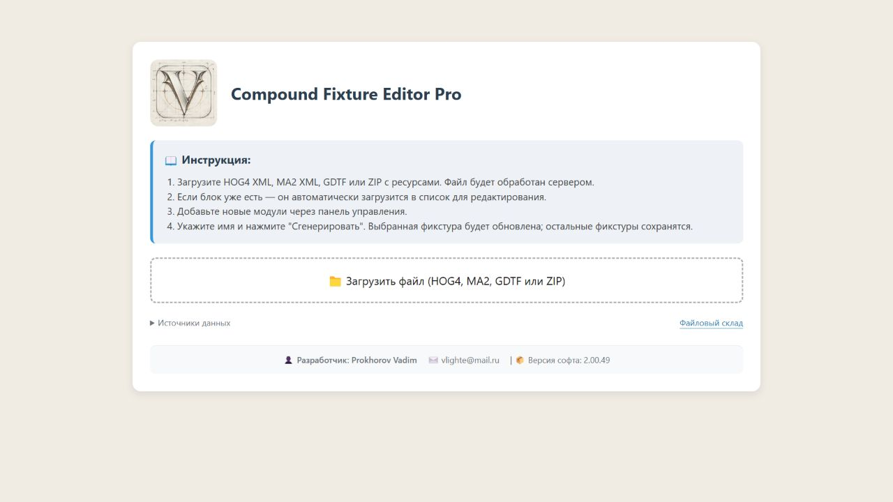

# IP1000 — контрольная точка 2.00.49

31 октября 2026. Версия установлена на vlighte.ru и сохранена в исходниках этой контрольной точки.

## Нативные измерения HOG 3.21.2 b3662

Использован оригинальный MA2 IP1000 42ch из `tests/fixtures/IP1000_MA42_original.xml`. Один составной прибор №1, патч1:A/1, профиль `IP1000 42ch TEST 2.00.49` (определения управления совпадают с обычным экспортом; отличаются только имена и UUID). Оператор вручную вводил значения, затем Programmer и DMX Output читались со снимков. Это программный DMX, физический прибор не подключён.

| Intensity / CMY | Канал3 | Главный RGB7/8/9 | Физический DIM3,14 | Отдельные15/19 |
|---|---|---|---|---|
| 50%,0/0/0 | 127 | 127/127/127 | 255 | Не оценивались |
| 0%,0/0/0 | 0 | 0/0/0 | 255 | 255/255 |
| 100%,0/0/0 | 255 | 255/255/255 | 255 | 255/255 |
| 100%,100/50/100 | 255 | 0/127/0 | 255 | 255/255 |

Подтверждены гашение основных каналов, перенос области виртуального DIM на канал3, независимость физического DIM3 и первой белой/RGB-ячеек. Канал3 не меняется от протестированного цветного CMY при DIM100. На половинном уровне остаётся разница127против128у оригинальнойMA2. НулевойDIM с цветнымCMY отдельно не измерялся, остальные ячейки не перебирались полностью. Полный диапазонSHUTTER и округлениеTilt остаются прежними ограничениями. HOG5.3.0 не установлен и не проверен. СгенерированныйMA2 этой версии нативно не импортировался.

[CSV измерений](native-dmx-observations.csv), [итог JSON](checks.json). Для каждого состояния сохранены пары `hog49-*-programmer.png` / `hog49-*-dmx.png`.

## Формат и исправления

Первоначальный XML генератора неверно указывал RGB как I Red/I Green/I Blue в Affected и включал физический Sub Intensity2. [Ручной экспорт M0 из HOG](M0_manual_fixed_reference.xml) показывает штатные CMY-связи. В 2.00.48 представление канала3 как I White нативно не прошло проверку из-за смены цветовой модели; оно заменено в 2.00.49 на Sub Intensity1 с исходным Default100 и Virtual/Affected. Sub Intensity2 остаётся независимым.

[Обычный HOG](IP1000_HOG42_2.00.49.xml), [однозначно названный тестовый HOG](IP1000_TEST_2.00.49.xml), [MA2 из HOG без комментариев восстановления](IP1000_MA_from_HOG_no_recovery.xml). Перенос явно затронутого вспомогательного уровня обратно в COLORRGB7 использует нативные поля; обычный физический DIM2 не переименовывается. При конфликте с занятым Sub Intensity1 или I White экспорт останавливается, независимые каналы не объединяются.

## Установка и проверка сайта

[Подтверждение установки](deployment.json), [сверка четырёх файлов и restart.txt](server-readback.json), [проверка рабочего API](live-checks.json). Исходники сверены после нормализации CRLF/LF. Главная и гостевая библиотека показывают2.00.49; список11записей загружается. Рабочий API принимает оригиналIP1000, создаёт HOG/MA2/GDTF; Channel/Default/Virtual/Affected совпадают с локальным профилем, проверенным в HOG. Тестовый архив в библиотеку не добавлялся, receipt/IP ответа не сохранялись. Резервные копии предыдущих файлов остаются локально и в репозиторий не включены.

Полный прогон выполнен: [результаты и обнаруженные регрессии](full-matrix/README.md). На прежних входах108ошибок, на новыхформатах/ZIP —по81. Предыдущие результаты в соседних каталогах сохранены как история.

